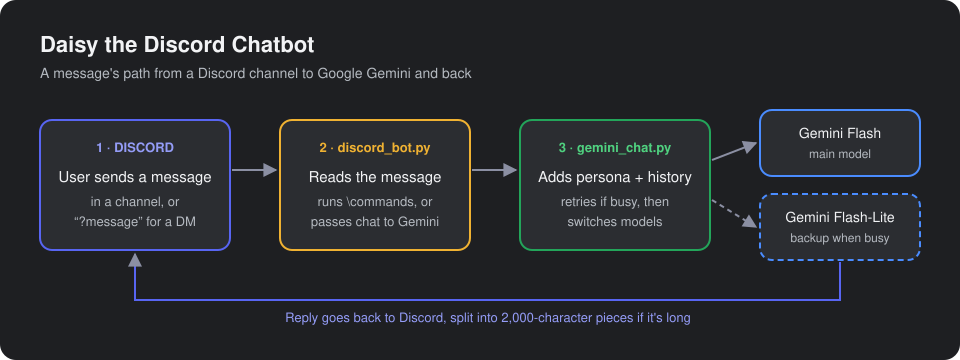

# Daisy the Discord Chatbot

A Discord chatbot powered by Google Gemini. Daisy chats in a server channel or by direct message, keeps track of the conversation, and has commands to rename her, pause her, and view the chat history.

Built during the **AI-STAARS** program at San Francisco State University (Summer 2024), and updated in 2026 to Google's current Gemini library and models.



## About the project

AI-STAARS (Artificial Intelligence Scholarships that Improve Academic Achievement, Retention, and Career Success) is an SF State scholarship program that gives computer science students early, hands-on experience with AI. This bot was my first project connecting a large language model to a real app that people use.

It started as a rule-based bot with hard-coded replies ("hello" → "Heya there!"). I then replaced those rules with Google Gemini, so Daisy can hold an actual conversation, and gave her a persona and a set of commands.

## Features

- **Conversations with memory:** Daisy remembers earlier messages in the chat, so follow-up questions make sense.
- **Custom persona:** a system instruction gives the bot its name and personality and keeps replies short enough for Discord.
- **Private replies:** start a message with `?` and Daisy answers by DM instead of in the channel.
- **Commands:**
  - `\set_name <name>`: rename the bot (25 characters max) and start a fresh conversation
  - `\stop_listening` / `\listen`: pause or resume replies
  - `\get_history`: show the conversation so far
- **Handles busy servers:** if Gemini is overloaded or slow, the bot retries, then switches to a lighter backup model so users still get a reply.
- **Long replies:** responses over Discord's 2,000-character limit are split into several messages.

## Tech stack

| | |
|---|---|
| Language | Python 3.12 |
| Discord | [discord.py](https://discordpy.readthedocs.io/) (async, event-driven client) |
| AI | Google Gemini API through [google-genai](https://pypi.org/project/google-genai/): `gemini-flash-latest`, with `gemini-flash-lite-latest` as backup |
| Config | python-dotenv, environment variables for the API keys |
| Tools | VS Code, Discord Developer Portal, Google AI Studio |

## Skills I practiced

- Integrating an LLM API into an application, including chat sessions and conversation history
- Prompt design: using a system instruction to set a bot's persona and response style
- Asynchronous, event-driven programming with Python's `async`/`await`
- Working with a third-party platform API: bot tokens, gateway intents, and permissions
- Keeping secrets out of code with environment variables and `.gitignore`
- Error handling for real-world API failures: retries, timeouts, and a fallback model
- Reading library documentation to update a project when an API changed (moving from `google-generativeai` to `google-genai`)

## What I learned

- **An LLM is only part of a chatbot.** Most of the work was around the model: routing messages, handling commands, remembering the conversation, and fitting replies into Discord's limits.
- **A few sentences of instructions shape the whole personality.** The system instruction decides the bot's name, tone, and reply length without retraining anything.
- **APIs change and servers get busy.** Coming back to this project two years later, the model it used had been retired and the library had been replaced. Building in retries and a backup model made the bot dependable even when Gemini is under high demand.
- **Secrets never belong in code.** Tokens and API keys live in a `.env` file that is never committed.

## How it works

| File | What it does |
|---|---|
| `main.py` | Entry point: loads the Discord token and starts the bot |
| `discord_bot.py` | The Discord client: reads messages, runs commands, sends replies |
| `gemini_chat.py` | Wraps the Gemini chat session: persona, history, retries, and fallback model |

## Run it yourself

You need Python 3.10 or newer, a Discord bot token from the [Discord Developer Portal](https://discord.com/developers/applications) (with **Message Content Intent** turned on), and a free Gemini API key from [Google AI Studio](https://aistudio.google.com/apikey).

```bash
python3.12 -m venv .venv
source .venv/bin/activate
pip install -r requirements.txt
cp .env.example .env   # then add your Discord token and Google API key
python main.py
```

To use a different model, set `GEMINI_MODEL` or `GEMINI_FALLBACK_MODEL` in `.env`.
